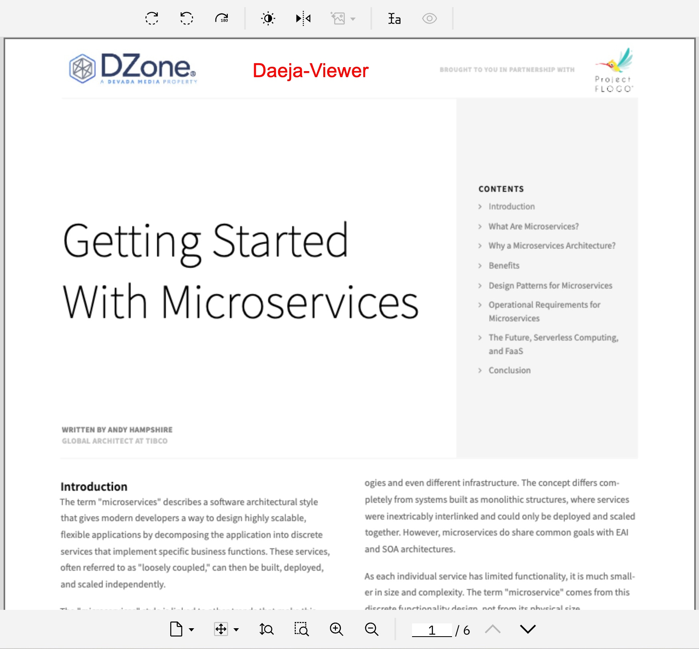
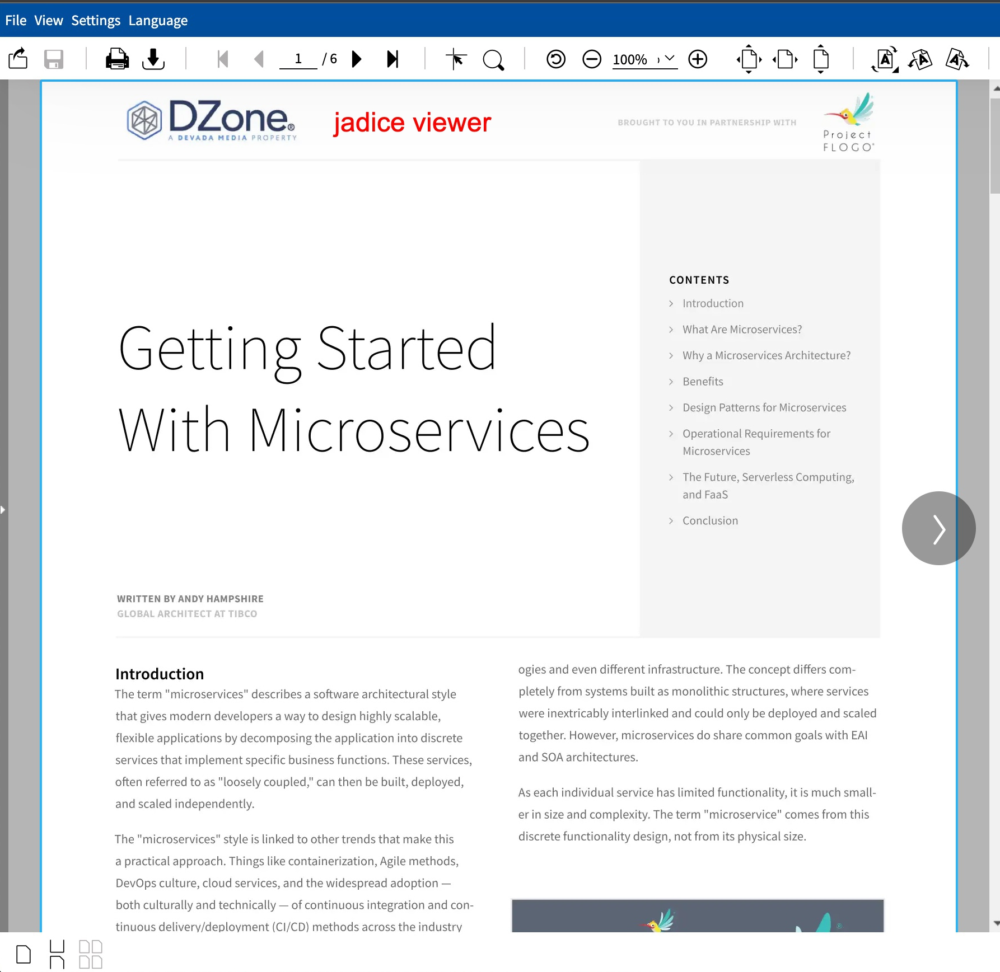

# webtoolkit-icn-plugin: ICN Plugin for jadice web toolkit

jadice® web toolkit is a web-based multi-format viewer for several formats like PDF, TIFF, AFP, MO:DCA, PNG, JPEG and more. 
With this plugin jadice can be configured in IBM Content Navigator as viewer for documents instead of Daeja One Viewer.

## Features

Below is a small list with features of the jadice web toolkit viewer

| Feature                        | Available          |
|--------------------------------| ------------------ |
| P8 Annotations (read)          | :heavy_check_mark: |
| P8 Annotations (write)         | :heavy_check_mark: |
| Filenet IS Annotations (read)  | :heavy_check_mark: |
| Extensibility                  | :star: :star: :star: |
| viewer can be used outside ICN | :heavy_check_mark: |
| OCR layer support              | :heavy_check_mark: |
| Javascript API for viewer      | :heavy_check_mark: |

### Render Quality

<a href="docs/daeja.jpg"></a>
<a href="docs/webtoolkit.jpg"></a>

## Version support

This plugin requires Content Navigator version 3.0.x and was tested with version 3.0.7 and version 3.0.9

## Installation

### Plugin Installation
1. Make sure the plugin JAR-file (e.g. webtoolkit-content-navigator-plugin-1.2.0.jar) is accessible from Content Navigator
2. Install the plugin via the admin-panel
3. Make sure you correctly define the "jadice web toolkit URL" field in the plugin installation process (e.g. http://myicnhost/webtoolkit , see below).
4. Create a view-mapping for the new plugin in the admin-panel
5. Make sure the view-mapping is applied for the desired desktop

### jadice web toolkit Installation

This url of jadice web toolkit configured in the plugin is used by the Content Navigator server to transfer 
the documents to the jadice web toolkit and in the viewing window of the web-browser (client). 
As the Content Navigator has a strict same-origin-policy, this URL must use the same base-path as the Content Navigator 
itself. To achieve this, either deploy the jadice web toolkit WAR-file on the same application server as the 
Content Navigator or use a proxy. Chapter 9.8 of the "*Customizing and Extending
IBM Content Navigator*" Redbook provides more information about this setup. Hint: configure `underscores_in_headers on` 
in Nginx if you're using Nginx as reverse-proxy.

#### Sidecar-deployment

In this setup, jadice web toolkit is installed on the same application server as the Content Navigator.
With this scenario you don't have to worry about same-origin problems. Unfortunately, if you need write
support for annotations, this setup won't work as the IBM P8 libraries seem to interfere with the libraries
that are loaded by the Content Navigator. The solution is a standalone-deployment of jadice web toolkit.

#### Standalone & Nginx

You can deploy jadice web toolkit to any other application server or run it as standalone application with Spring Boot.
Since the Content Navigator plugin embeds the jadice viewer with an iframe, the same-policy-origin blocks the viewer
from rendering in this setup. A reverse-proxy is needed to the Content Navigator and the jadice viewer do have
the same origin.

If you choose Nginx for this job, make sure you enable the option `underscores_in_headers on` in the server-block.
An example configuration could look like this:
```text
server {
  server_name ecm.levigo.de;
  listen 8080 default_server;
  underscores_in_headers on;

  location /navigator/ {
    proxy_pass http://localhost:9081/navigator/;
    proxy_set_header X-Real-IP $remote_addr;
    proxy_set_header X-Forwarded-For $proxy_add_x_forwarded_for;
  }

  location /webtoolkit/ {
    proxy_pass http://localhost:8090/webtoolkit/;
  }
}
```

### Configuring write support for annotations

Since version 1.2.0 of the plugin, it is possible to persist changes made to a document. The annotations are directly
stored to the P8 repository by the jadice web toolkit. Enable **"Load and save P8 annotations via jadice"** in the
plugin configuration (off by default); the plugin then hands the P8 object id to jadice and opens the document via
`icn://`, which requires `webtoolkit-content-navigator-integration` and the P8 connection (`webtoolkit.icn.p8.uri`,
`.domain`, `.user`, `.password`, `.os`) in the `application.yml` of the jadice web toolkit. With the option disabled,
documents are opened via `upload://` and only displayed. The plugin itself holds no P8 credentials.

## Integration

### How the plugin talks to jadice web toolkit

1. The plugin (running inside the Content Navigator server) downloads the document from ICN and posts it as
   `multipart/form-data` to `<jadice web toolkit URL>/upload` (endpoint of the `webtoolkit-addon-upload` module).
   For P8 repositories the form field `metaMapFlat` carries `p8Id=<objectStoreId>,<documentId>`.
2. The response is an upload id. The plugin opens the viewer in an iframe with the generic source parameter
   `?u={"uri":"icn://<uploadId>"}` (URL-encoded). For non-P8 documents, or when the user may not edit annotations,
   the plain `upload://<uploadId>` is used instead, so the ICN integration module is only needed for P8 annotations.

No P8 credentials are transferred. Upload limits are those of the jadice web toolkit server
(`spring.servlet.multipart.max-file-size`). The `/upload` endpoint is unauthenticated; restrict it to the ICN server
at network or reverse-proxy level.

### jadice web toolkit integration

Your jadice web toolkit installation needs the following module (it pulls in `webtoolkit-p8-integration` and
`webtoolkit-addon-upload`), so it can serve the documents transferred by the webtoolkit-icn-plugin

```xml
<dependency>
    <groupId>com.levigo.jadice.webtoolkit</groupId>
    <artifactId>webtoolkit-content-navigator-integration</artifactId>
</dependency>
```

The module is part of the jadice web toolkit and bound to the respective version. More information can be found in the README.md of this module.

## Development

- Get a j2ee.jar (e.g. from your Application server) and place it under /lib
- Get navigatorAPI.jar from Content Navigator and place it under /lib
- Run maven task e.g. `mvn install`

## License

[Apache License 2.0](https://github.com/levigo/webtoolkit-icn-plugin/blob/master/LICENSE)
